# Stock Market Academy

[](https://github.com/SGhunter666/Stock_Tutorial_Godot/actions/workflows/deploy-web.yml)

A single-player **16-bit pixel-art** financial education and trading simulation built with **Godot 4** — fusing an interactive Kairosoft-inspired pixel trading floor with a crisp PC-98 CRT terminal, procedural 16-bit FM chiptune music, stepped pixel indicator curves, and segmented LED order-book depth. Players start as a retail investor in a deterministic simulated market, learn trading, risk, options, futures, multi-asset investing, quantitative research, fund management and career decision-making, and follow a complete story arc from apprentice to fund leader.

- Version: `beta-15` (100% Full 16-Bit Pixel Edition · 100-Stock Universe, 5-Tier Font Scaling & Web HTML5)
- **🌐 Play in Browser (No Download)**: <https://sghunter666.github.io/Stock_Tutorial_Godot/> (IndexedDB persistent saves + native browser PNG diploma poster & JSON save import/export)
- Engine: Godot `4.7+` (tested on `4.7.2`)
- Renderer: GL Compatibility (integer bitmap font scaling, `NEAREST` filtering, WebGL 2 single-threaded WASM)
- Languages: Simplified Chinese / English
- Platforms: Web (HTML5 / WASM), Windows & macOS (all 3 export presets included), Linux from source
- Repository: <https://github.com/SGhunter666/Stock_Tutorial_Godot>
- Original project: <https://github.com/SGhunter666/STOCK_Tutorial>

Check [GitHub Releases](https://github.com/SGhunter666/Stock_Tutorial_Godot/releases) for published Windows builds. Download the ZIP, extract it, and open the executable.

After reviewing your first trade, open **Opening Gap** from the dashboard. Make an opening decision with the dedicated training account, then compare a different choice on the same price path.

> **Disclaimer**
>
> All companies, prices, news, financial statements, clients and story events are fictional or simulated for teaching. The history lab uses bundled real daily bars, but it is still an offline replay, not live market data. The game does not connect to brokers, execute real orders, move real money, or provide investment, tax or legal advice.

---

## Highlights

| Item | Count / Content |
| --- | --- |
| Simulated stocks | **100 simulated equities** (63 real-world-inspired icons such as `Nvidie`, `TaiSemi`, `Broadkom`, `Berkshyre`, `Eli Lillie`, `Costko` + 37 original issuers across 11 sectors, ≥ 4 per sector) |
| ETFs | 4: `MKT`, `TECH`, `DIV`, `SMAL` |
| Academy | 32 core units (core + 4 parallel tracks, 85% placement test-out) + 6 branch units = 38 units |
| Academy stages | 8 |
| Glossary | 85 terms |
| Story & Campaigns | 16 stories, 36 triggers, 7 animated PC-98 pixel characters + playable Opening Gap & Black Friday crisis campaigns |
| Challenges & Daily Sprint | 14 goal-based challenges + **Daily Same-Seed 10-Day Sprint** with risk-adjusted leaderboard |
| Pixel Office Renovation | Zero-ledger-impact `RP` workshop (6 toggleable pixel props) + 7 hired fund specialist roles stationed live on the trading floor |
| Achievements & Posters | 30 achievements + 1-click **16-Bit Gold-Rimmed Pixel Diploma / Battle Poster PNG** export |
| Career ranks | 8 |
| Fund roles | 7 |
| History lab | 4 real daily-bar scenarios |
| Pages | 30 (28 grouped sidebar surfaces in 6 collapsible domains + 2 playable scenario screens) |
| Save | Local JSON, 4 independent career slots, export/import & Graduation Report Card JSON export |

The default seed is `academy-2026` and the default starting cash is **USD 100,000**. A trading day runs from **09:30 to 16:00** and contains 23,400 simulated seconds.

---

## Screenshots

### Trading Desk & Upgraded Pixel Floor (Kairosoft Oak Desk × CRT Pixel Hybrid — Default Style A+B)

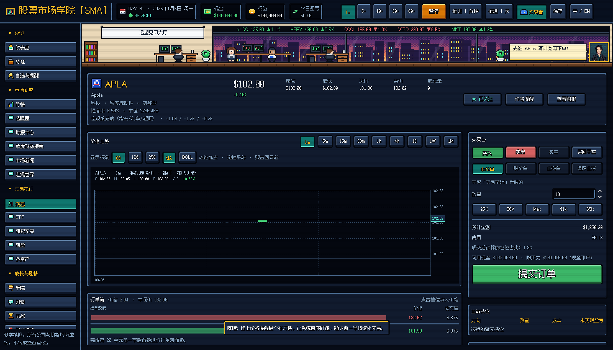

### Kairosoft Pixel Desk Renovation Workshop & Specialist Roster

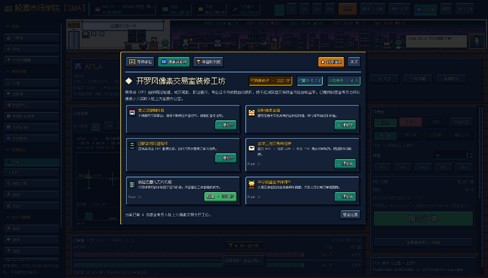

### 16-Bit Gold-Rimmed Pixel Diploma & Battle Poster (1-Click PNG Export)

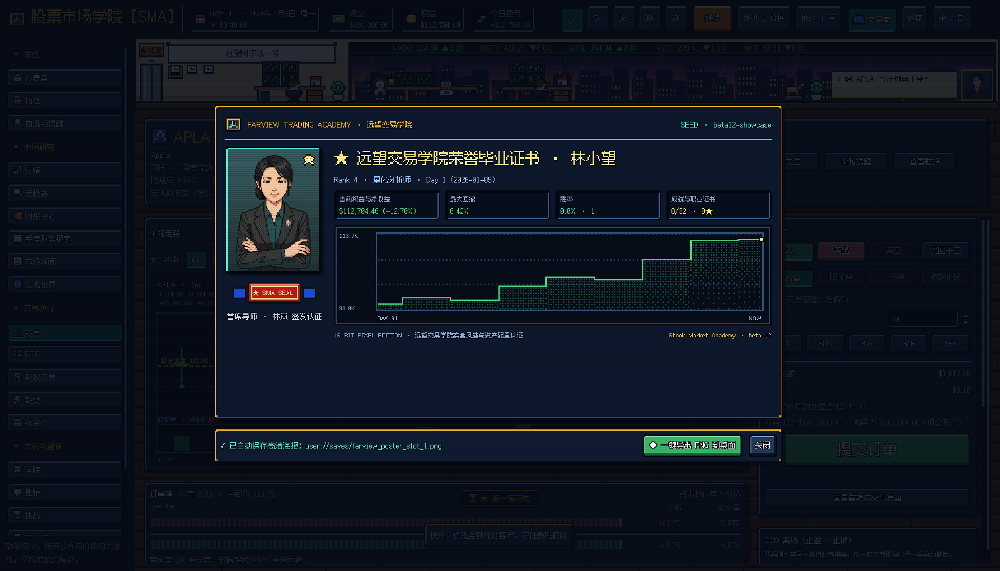

### Daily Same-Seed 10-Day Sprint & Personal Best Leaderboard

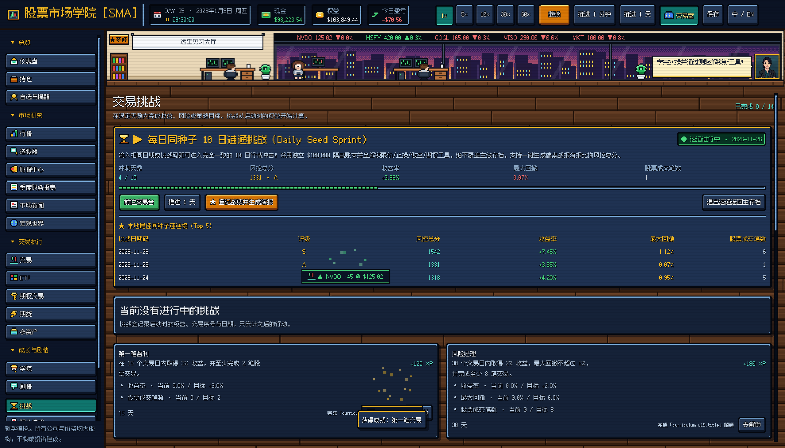

### Animated PC-98 Character Portraits (Blinking, Lip-Sync & Pixel Emote Badges)

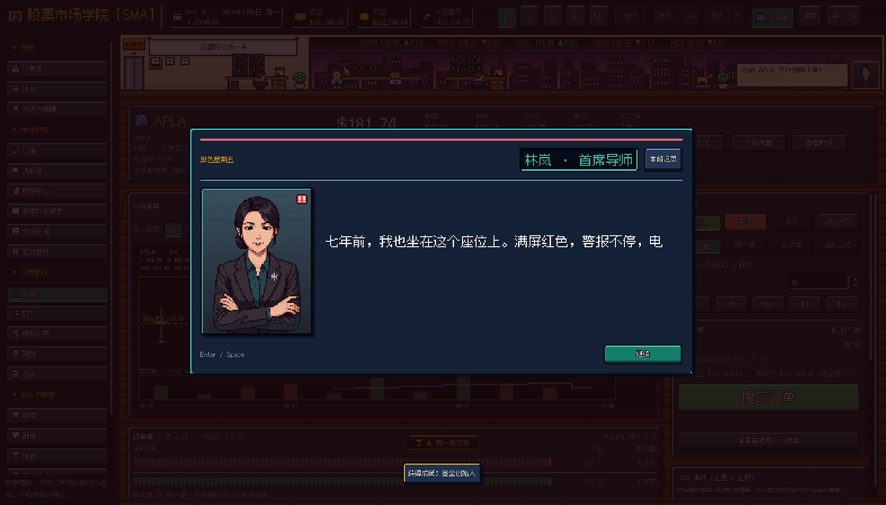

### Kairosoft Warm Cream Parchment Pixel Palette (Style B)

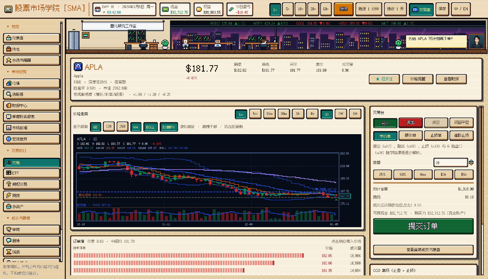

### Dashboard & Interactive Pixel Trading Floor

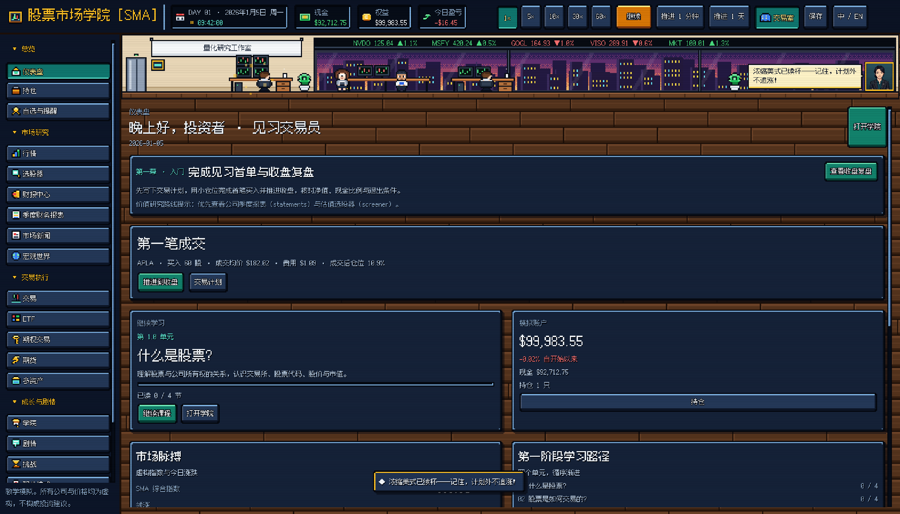

### Market Board & Sector Heatmap

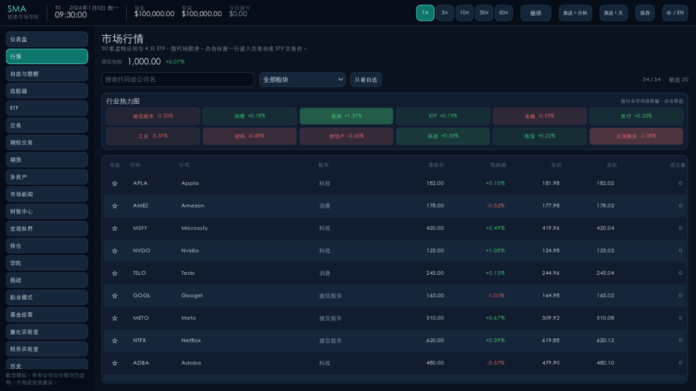

### Portfolio & Bayer-Dithered CRT Equity Curve

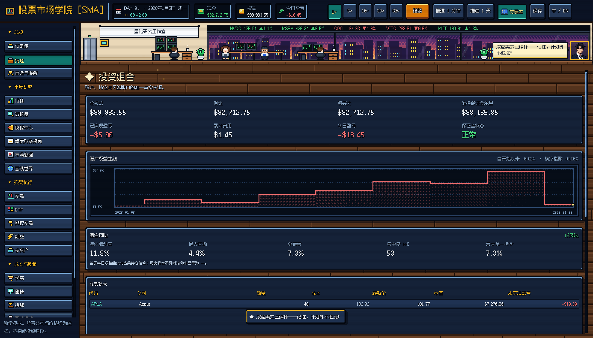

### Watchlist & Price Alerts

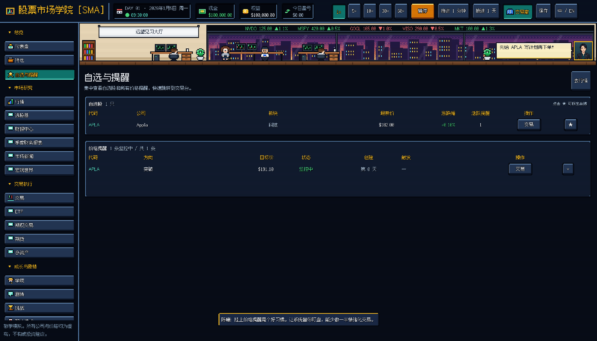

### Stock Screener

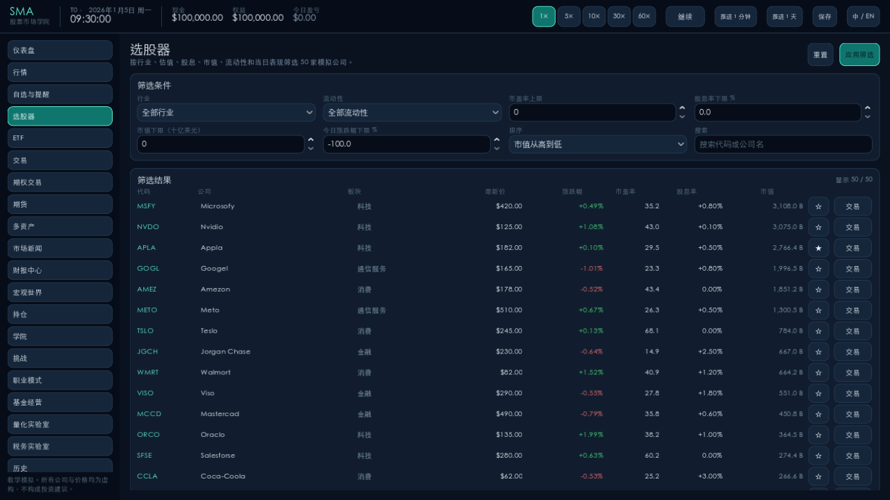

### Earnings Center

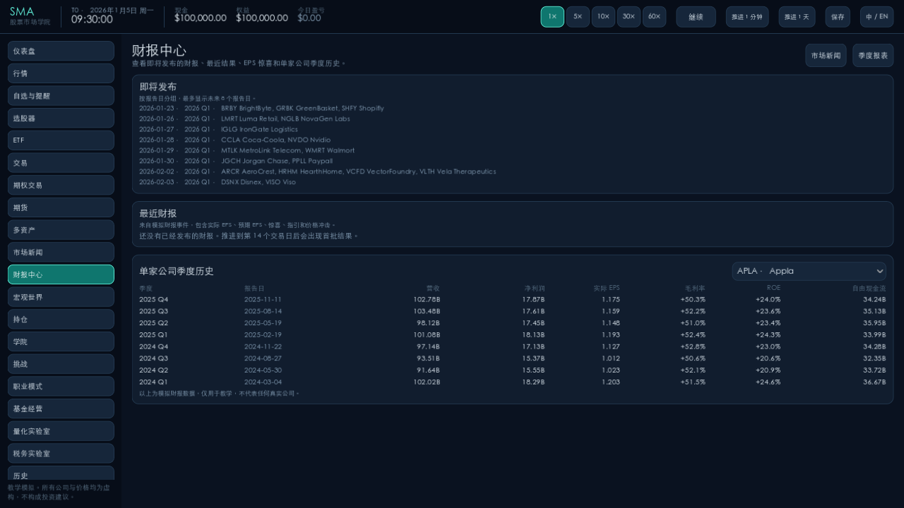

---

## Pages

| Page | What it covers |
| --- | --- |
| Dashboard | Account snapshot, learning progress, achievements, review and recent activity |
| Market | Live simulated quotes for 50 stocks and 4 ETFs, search, sector filter, watchlist filter and sector heatmap |
| Watchlist | Every followed ticker, active alerts and triggered alerts, with jump/delete actions |
| Screener | Filter companies by sector, valuation, dividend yield, market cap, liquidity and today's move |
| ETF | ETF quotes, NAV, holdings, weights and trading entry |
| Trade | Candles, order book, market/limit/stop/trailing/OCO orders, shorting, margin, positions and working orders |
| Options | Chains, buy/sell, Greeks, collateral, European/American style, strategy presets and positions |
| Futures | Futures chain, long/short, margin and positions |
| Multi-asset | Bonds, FX, commodities and crypto quotes, trades and positions |
| News | News, earnings calendar, corporate actions and rights offerings |
| Earnings | Upcoming reports, recent results, EPS surprises, guidance, price impact and quarterly history |
| Macro | Macro indicators, calendar, global markets and sector sensitivities |
| Portfolio | Stock/ETF/option/futures/multi-asset positions, P&L, exposure and risk summary |
| Academy | 8 stages, 38 units, quizzes, practice checks, demos, glossary and tool unlocks |
| Challenges | 14 bounded trading challenges with return, drawdown and structural targets |
| Career | 8 ranks, research tasks, investment reports, evaluations and salary |
| Fund | Fund creation, clients, staff, NAV, attribution, risk model, leaderboard and redemptions |
| Quant | 5 strategies, backtests, optimization, factor research, regression and ML experiments |
| Tax | UK 2026/27 tax estimate, CGT, dividends, disposals and cost-pool matching |
| History | Four real daily-bar scenarios with day-by-day lab trading |
| Replay | Day-by-day account snapshots and position history |
| Statements | Up to 8 quarters of simulated financial statements |
| Glossary | 85 financial terms with definitions and examples |
| Sandbox | Custom cash, seed, difficulty and commission; never overwrites the career save |
| Roadmap | Implemented scope and future plans |
| Boundaries | What is simulated, what is real, and what the engine does not claim |
| Settings | Language, theme, layout, resolution, UI scale, audio and save export/import |
| Story | Story archive, characters, chapter review and current story entry |

---

## Quick Start

### Requirements

- Godot **4.7 or newer** (4.7.2 recommended)
- A desktop environment with GL Compatibility support
- No network connection required

### Run from the editor

1. Open the project root in Godot.
2. Wait for the first import to finish.
3. Press `F5` to run `ui/main.tscn`.

### Run from the command line

```bash
godot --path .
```

On macOS with the official app bundle:

```bash
/Applications/Godot.app/Contents/MacOS/Godot --path .
```

### Start a game

The start screen offers:

- **New game**: create a career save and play the opening story.
- **Continue**: load `user://saves/career.json`.

The market clock starts automatically after the opening story or when you load a career. It pauses during story dialogue.
New careers begin with Today’s Task on the dashboard. Write an optional trade plan, place a simulated order, and review its fill, fees, position size and closing cash share.

### Windows build

```text
build/windows/StockMarketAcademy_beta-03.1.exe
```

`build/` is ignored by Git.

---

## Controls

| Shortcut | Action |
| --- | --- |
| `F1` | Open / close shortcut help |
| `Ctrl + S` / `Cmd + S` | Save now |
| `Space` | Pause / resume |
| `1` | 1× speed |
| `2` | 5× speed |
| `3` | 10× speed |
| `4` | 30× speed |
| `5` | 60× speed |
| `N` | Fast-forward one trading day |
| `M` | Advance one minute |
| `Esc` | Close shortcut help |

Shortcuts are blocked while a text field, dropdown or other focusable control owns the keyboard, during stories, during fast-forward, or on the start overlay.

Mouse actions:

- Use the left sidebar to switch pages.
- Click a market row to open the trading desk or ETF page.
- Click `☆ / ★` on a market row to toggle the watchlist.
- Use the trade header to follow the current ticker or open price alerts.
- In the alert dialog, choose **Above / Below**, enter a target price, then add or delete alerts.

---

## Systems

### Simulation

- 50 fictional companies across technology, communication, consumer, financials, healthcare, industrials, energy, materials, real estate, utilities and telecom.
- 4 ETFs whose NAV is derived from component weights.
- Deterministic seed: the same seed reproduces the same market.
- 23,400 simulated seconds per trading day, 09:30 to 16:00.
- Speed from 1× to 60×, pause, step one minute and step one day.
- Quotes include last, change, bid, ask, volume, high, low, order book depth and candles.
- Market search, sector filtering, watchlist filtering and an interactive sector heatmap.

Sector access unlocks with the academy:

| Unlock | Sectors |
| --- | --- |
| Default | Technology, communication, consumer, financials |
| Complete `u4` | Healthcare, industrials |
| Complete `u7` | Energy, materials |
| Complete `u13` | Real estate, utilities, telecom |
| Complete `u7` | ETF trading |

Existing positions in locked sectors are not force-closed; new buys are rejected.

### Academy and tool unlocks

The academy contains 8 stages, 32 core units and 6 branch units.

- Each unit has reading sections, practice checks and a quiz.
- The quiz pass mark is **80**.
- Reading, practice, quizzes and unit completion award XP.
- Progress is verified from real learning records, not manual checkboxes.
- Interactive demos cover candles, financial statements, DCF, macro, allocation, risk, strategies, Greeks, option payoffs, futures, hedging and stress tests.
- The glossary contains 85 terms.

| Tool | Unlock |
| --- | --- |
| Limit orders | `u4` / `s3` |
| Short selling | `u17` / `s1` |
| Margin | `u18` / `s1` |
| Stop orders | `u19` / `s1` |
| Order book depth | `u20` / `s1` |
| Option buying | `u21` / `s1` |
| Option selling | `u25` / `s1` |
| Futures | `u29` / `s1` |
| Multi-asset | `u13` |
| ETF | `u7` |

### Trading

- Order types: market, limit, stop, trailing stop and OCO.
- Sides: buy, sell, short and cover.
- Margin, buying power checks and margin calls.
- Candles: `1m`, `5m`, `15m`, `30m`, `1h`, `4h`, `1D`, `1W` and `1M`.
- Candle ranges: 60, 120 and 250 bars.
- Advanced layout adds a technical-indicator card.
- Order book depth shows price and size on both sides.
- The trade page shows positions, working orders, estimated value, fees, available cash and buying power.
- The header links to financial statements, the watchlist and price alerts.

### ETFs

| Ticker | Name | Description |
| --- | --- | --- |
| `MKT` | Sim Broad Market ETF | Broad simulated market basket |
| `TECH` | Innovation Leaders ETF | Technology and innovation leaders |
| `DIV` | Dividend Income ETF | Dividend income basket |
| `SMAL` | Small Cap Growth ETF | Small-cap growth basket |

- ETF prices/NAV are derived from component weights.
- Each session close marks the fund to NAV and rebuilds the market-maker ladder.
- The ETF page shows holdings, weights, expense ratio, NAV and a trading entry.
- ETF intraday `last` is not revalued every second, so ETF price alerts fire at the session close.

### Options

- Expiries: 30, 60 and 90 days.
- Calls and puts across strikes and European/American settlement.
- Buy, sell, close, exercise, early assignment and collateral.
- Greeks and chain quotes.
- Six strategy presets:
  - Covered call
  - Cash-secured put
  - Bull call spread
  - Bear put spread
  - Long straddle
  - Long strangle
- Settlement style locks while contracts are open.

### Futures

- Multiple expiry cycles.
- Long/short open and close, margin, fees and position P&L.
- Shares account equity and risk constraints with stocks, ETFs and options.

### Multi-asset

- Bonds: quotes, buy, sell and positions.
- FX: currency pairs, buy, sell and positions.
- Commodities: quotes and positions.
- Crypto: quotes and positions.

### News, earnings and corporate actions

- Market news and event feed.
- Earnings calendar and same-day earnings toasts.
- Every company reports once per quarter on its own stable slot.
- The earnings center shows upcoming dates, recent results, EPS surprise, guidance and price impact.
- The statements page shows up to 8 quarters.
- Dividends, splits, rights issues, buybacks, halts and other corporate actions.
- Rights offerings can be accepted or declined.

### Macro and global markets

- Macro indicators and sector sensitivities (growth, rates, energy).
- Macro calendar.
- Global market performance.
- Macro shocks feed both the market and story events.

### Portfolio, review and replay

- Stock, ETF, option, futures, bond, FX, commodity and crypto positions.
- Realized/unrealized P&L, cash, equity, exposure, concentration and risk summary.
- Review summary and timeline.
- Replay account snapshots day by day.

### Watchlist, alerts and screener

- Market rows have `☆ / ★` toggles; the market page can show the watchlist only.
- The trade page has a follow button and a price-alert button.
- The Watchlist page centralizes:
  - All followed tickers with last price, change and active alert count.
  - All alerts with direction, target, status, creation day and trigger record.
  - Jump, delete and clear-triggered actions.
- Alert directions:
  - **Above**: trigger when last ≥ target.
  - **Below**: trigger when last ≤ target.
- Alerts fire once and are marked as triggered.
- Multiple alerts in the same frame are merged into one toast.
- Maximum 200 alerts.
- Alerts are checked every 10 simulated seconds.
- Watchlist and alerts are stored in the save; old saves without the fields load as empty lists.

The screener supports:

- Sector and liquidity filters.
- Maximum P/E.
- Minimum dividend yield.
- Minimum market cap in USD billions.
- Minimum today's change.
- Ticker/company search.
- Sorting by market cap, today's change, dividend yield, P/E or ticker.
- Filters persist in the save.

### Sector heatmap

The market page shows average performance for 11 stock sectors plus ETFs:

- Green means the sector is up on average; red means down.
- Color intensity follows the average move.
- Clicking a tile applies that sector filter to the market table.
- The heatmap updates with the simulated market.

### Story

- 16 stories, 36 triggers and 7 main characters.
- Characters: Lin Lan, Gu Yan, Su He, Zhou Heng, Mr. Wang, Chen Xi and Lao Chen.
- Dialogue supports half-body portraits, character theme colors and flag-dependent narration.
- Conditions include flags, seen stories, finished stories, unit completion and fund state.
- Effects include setting flags, cash changes, toasts and real fund-client subscriptions.
- Choices affect branches, trust and endings.
- Full outline: [docs/story_outline.md](docs/story_outline.md).

### Challenges and achievements

14 challenges: First Profit, Risk Manager, Hedger, Options Income Desk, Volatility Desk, All-Round Trader, Dividend Collector, ETF Allocator, Short Seller, Options Starter, Options Income, Futures Starter, Multi-Asset Explorer and Cash Guard.

30 achievements cover learning, trading and career milestones.

### Career

8 ranks:

1. Retail Investor
2. Independent Trader
3. Equity Research Analyst
4. Quant Analyst
5. Portfolio Manager
6. Hedge Fund Manager
7. Fund Founder
8. Financial Group CEO

Promotion requires units, trades, equity, demos, reports, challenges or evaluations. Research tasks, investment reports and performance evaluations are included. Fund management unlocks at Portfolio Manager.

### Fund management

- Create a fund with name, strategy, risk profile, initial AUM, management fee, performance fee, benchmark, hurdle rate, leverage and tax profile.
- Client subscriptions, a story-driven client and redemption settlement.
- Seven staff roles: research, trading, risk, quant, macro, operations and compliance.
- Fund NAV, returns, drawdown, attribution, risk model and leaderboard.
- Portfolio optimizer with applicable weights.
- Fund state is saved and affects story branches.

### Quantitative lab

Five strategies:

- Buy and hold
- SMA cross
- RSI mean reversion
- Momentum
- Breakout

Features: backtest, parameter optimization, factor research, regression and machine-learning experiments.

### Tax lab

- UK **2026/27** educational estimate.
- Account type, income band and taxable income inputs.
- Capital gains tax, dividend tax and disposal records.
- Same-day, 30-day and Section 104 cost-pool matching.
- Does not modify the account and is not tax advice.

### History lab and replay

| Scenario | Period | Theme |
| --- | --- | --- |
| 2008 financial crisis | 2007-07 to 2009-06 | Lehman, bailouts and the bottom |
| 2015–2026 long cycle | 2015-01 to 2026-10 | Low rates, pandemic, hikes and AI |
| 2020 crash and rebound | 2020-01 to 2020-12 | Circuit breakers, zero rates and tech |
| 2022 rate-hike drawdown | 2022-01 to 2022-12 | Inflation, hikes and de-rating |

- Uses bundled real daily bars.
- Day-by-day trading with an independent run account.
- "Daily mode" disables intraday ticks and trades at the real close.
- Replay shows career-account snapshots by day.

### Sandbox

- Custom starting cash from 1,000 to 10,000,000.
- Custom seed.
- Difficulty: easy, normal or hard.
- Commission changes with difficulty: 0, 1 or 3 basis points.
- Uses a separate book and never writes the career save.
- Exiting restores the career save from before the sandbox.

### Settings

- Language: Simplified Chinese / English.
- Pixel Palette: Kairosoft Desk × CRT Pixel (A+B default) / Kairosoft Warm Cream Pixel (Style B) / PC-98 Midnight Pixel (Style A).
- Color scheme: International (green up / red down), China A-share (red up / green down), or Colorblind-friendly (blue / orange).
- Layout: beginner / advanced.
- Display mode: windowed / fullscreen.
- Window presets: `1280x720`, `1280x800`, `1366x768`, `1440x900`, `1600x900`, `1680x1050`, `1920x1080`, `1920x1200`, `2560x1440`, `2560x1600`, automatic.
- UI scale: auto / `1.0` / `1.1` / `1.25`.
- Audio: master, 16-bit FM music, SFX and mute.
- 4 independent career save slots & JSON export/import.

---

## Save

- Default path: `user://saves/career.json`
- Automatic save every **20 seconds**.
- Manual save with `Ctrl + S` / `Cmd + S` or the top-bar save button.
- Saves keep the previous successful write as `career.json.bak`. The game can read that backup if the primary save is damaged.
- Format: JSON, current `version = 1`.
- Saved state includes settings, selected ticker, exchange, story, academy, history lab, challenges, career, quant config, fund, watchlist and price alerts.
- Missing fields in old saves are normalized.
- Sandbox mode never overwrites the career save.
- The settings page exports and imports JSON saves. An import replaces career progress after validation succeeds.

Typical disk locations:

- Windows: `%APPDATA%\Godot\app_userdata\Stock Market Academy\saves\career.json`
- macOS: `~/Library/Application Support/Godot/app_userdata/Stock Market Academy/saves/career.json`
- Linux: `~/.local/share/godot/app_userdata/Stock Market Academy/saves/career.json`

---

## Tests

### Unit tests

```bash
godot --headless --path . --script res://tests/run_tests.gd
```

Expected output:

```text
ALL TESTS PASSED (31788 checks)
```

### Integration test

```bash
godot --headless --path . res://tests/integration.tscn
```

Expected output:

```text
INTEGRATION OK equity=99913.39 day=1 stories=16
```

### Screenshot check

Requires a real renderer:

```bash
SMA_SHOT_DIR=/tmp/sma_shots godot --path . res://tests/screenshot.tscn
```

macOS app bundle:

```bash
/Applications/Godot.app/Contents/MacOS/Godot --headless --path . --script res://tests/run_tests.gd
/Applications/Godot.app/Contents/MacOS/Godot --headless --path . res://tests/integration.tscn
```

---

## Export Windows & macOS Builds

Presets `Windows Desktop` and `macOS` are configured in `export_presets.cfg` with nearest-neighbor pixel icon scaling (`icon_interpolation = 0`):

```bash
godot --headless --path . --export-release "Windows Desktop" build/windows/StockMarketAcademy_beta-11.exe
godot --headless --path . --export-release "macOS" build/macos/StockMarketAcademy_beta-11.zip
```

- Godot `4.7.2.stable` export templates must be installed.
- `build/` is ignored by Git.
- Version comes from `project.godot` (`beta-11`).

---

## Project Structure

```text
.
├── app/                    # Autoloads and services
│   ├── audio.gd            # Audio and volume
│   ├── display.gd          # Resolution, window mode, UI scale
│   ├── game.gd             # Main state, clock, saves and business API
│   ├── i18n.gd             # Bilingual UI text
│   └── save_service.gd     # Atomic JSON save I/O
├── core/                   # Pure logic modules
│   ├── academy.gd          # Academy, XP, achievements, unlocks
│   ├── alerts.gd           # Watchlist and price alerts
│   ├── exchange.gd         # Deterministic simulated exchange
│   ├── options.gd          # Option pricing and chains
│   ├── option_strategies.gd
│   ├── futures.gd
│   ├── etfs.gd
│   ├── bonds.gd / fx.gd / commodities.gd / crypto.gd
│   ├── challenges.gd / career.gd / fund.gd / quant.gd
│   ├── tax.gd / history.gd / replay.gd
│   ├── earnings.gd / corporate.gd / news.gd / macro.gd
│   ├── order_book.gd / margin.gd / indicators.gd
│   └── ...
├── data/
│   ├── companies.json
│   ├── academy/curriculum.json
│   ├── stories/            # manifest, triggers, characters and 16 stories
│   └── history/            # catalog and 4 real daily-bar scenarios
├── narrative/story_service.gd
├── ui/
│   ├── main.tscn / main.gd
│   ├── kit.gd / theme.gd / screen.gd
│   ├── screens/            # 28 screens
│   └── components/         # charts, dialogue, dialogs and alerts
├── locales/
│   ├── zh_CN.json
│   └── en.json
├── tests/
│   ├── run_tests.gd
│   ├── integration.tscn
│   ├── screenshot.tscn
│   └── test_*.gd
├── docs/
│   ├── story_outline.md
│   └── screenshots/
├── build/windows/          # exported build (gitignored)
└── project.godot
```

---

## Data-Driven Extension

- Add companies in `data/companies.json`.
- Add academy units in `data/academy/curriculum.json`; update `TOOL_RULES` or `SECTOR_UNLOCK` in `core/academy.gd` when a unit unlocks tools or sectors.
- Add stories in `data/stories/`, register them in `manifest.json`, and add triggers in `triggers.json`.
- Add characters in `data/stories/characters.json`.
- Add history scenarios in `data/history/` and register them in `catalog.json`.
- Add UI text to both `locales/zh_CN.json` and `locales/en.json`.

Code layers:

- `core/`: pure logic, no UI dependencies.
- `app/game.gd`: state, business API and signals.
- `ui/`: calls Game APIs and listens to signals; never mutates the account or market directly.
- `tests/`: pure logic and integration coverage.

---

## Boundaries

- All stocks, ETFs, news, statements, clients and stories are simulated.
- The history lab uses bundled real daily bars but is limited to four offline scenarios.
- No broker connection, real orders, real money, live quotes, cloud saves, multiplayer or accounts.
- ETF NAV updates at session close; ETF alerts fire at the close.
- Price alerts are checked every 10 simulated seconds, not every tick.
- The tax lab covers UK 2026/27 estimates only.
- Saves are local 4-slot JSON files; use export/import to move them between machines.

---

## License & Credits

- **Source code & original pixel assets:** [MIT License](LICENSE).
- **Bundled bitmap fonts:** [Fusion Pixel Font](https://github.com/TakWolf/fusion-pixel-font) (`10px` & `12px` proportional Simplified Chinese) by TakWolf, licensed under the [SIL Open Font License 1.1](assets/fonts/OFL.txt).

---

## Links

- [Story outline v0.2](docs/story_outline.md)
- Original project: <https://github.com/SGhunter666/STOCK_Tutorial>
- Godot repository: <https://github.com/SGhunter666/Stock_Tutorial_Godot>

---

- **Version:** `beta-11`
- **Engine:** Godot 4.7+
- **Languages:** Simplified Chinese / English
