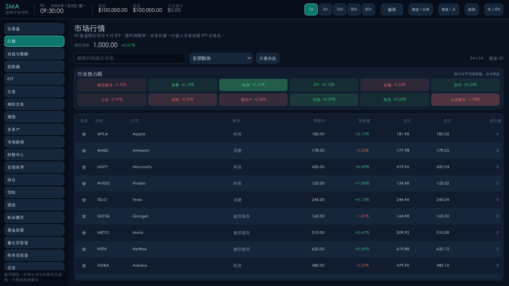
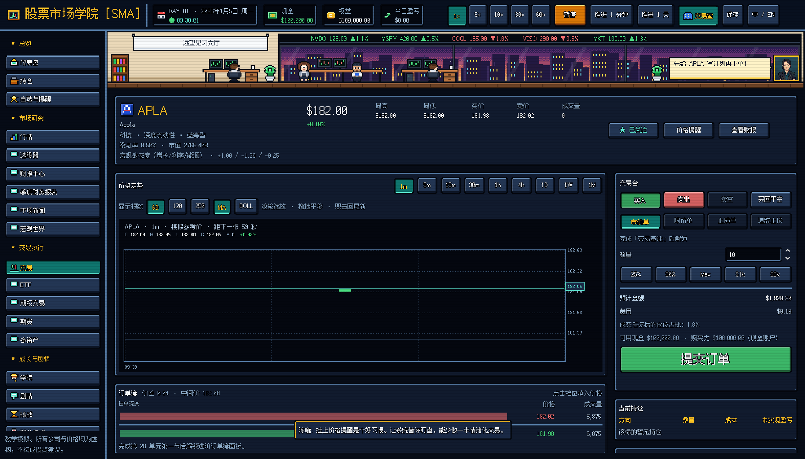
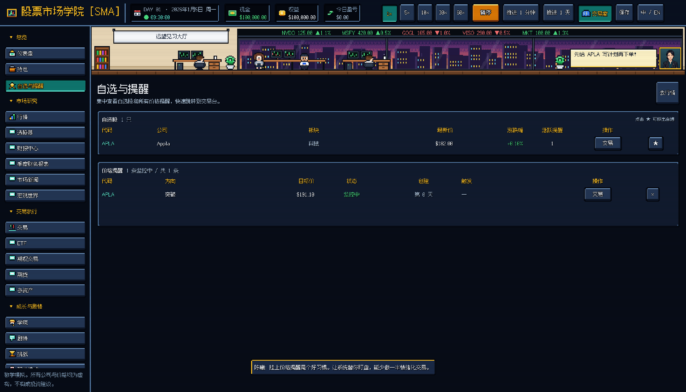
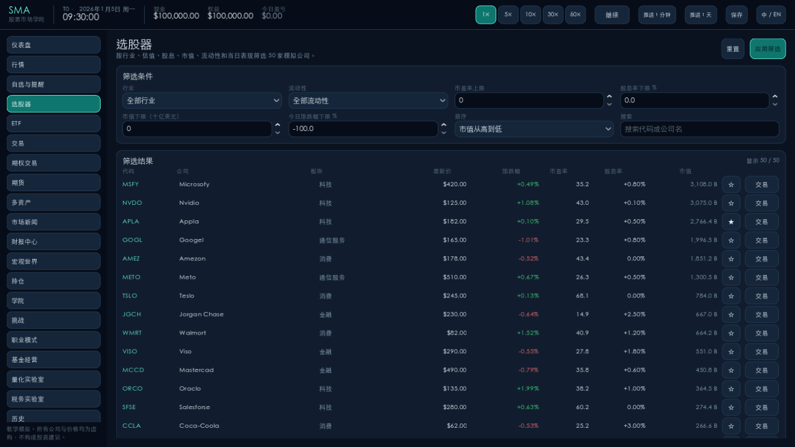
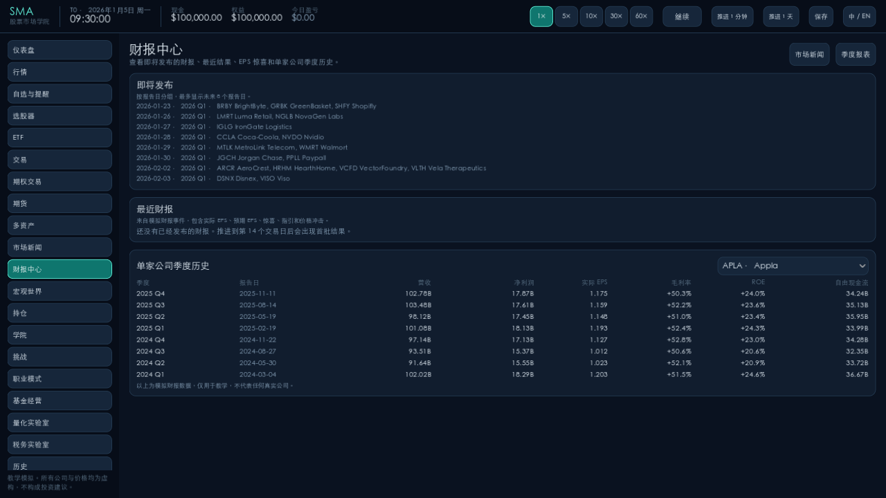

# Stock Market Academy / 远望交易学院

一个使用 **Godot 4** 开发的单机金融教学与交易模拟游戏。玩家从个人投资者起步，在确定性的模拟市场中学习交易、风控、期权、期货、多资产、量化、基金管理和职业决策，并在一段完整的职场剧情中从学徒成长为基金掌舵人。

- 当前版本：`beta-03.1`
- 引擎：Godot `4.7+`（已在 `4.7.2` 测试）
- 渲染：GL Compatibility
- 语言：简体中文 / English
- 平台：Windows（已导出）、macOS / Linux 可从源码运行
- 仓库：<https://github.com/SGhunter666/Stock_Tutorial_Godot>
- 原始项目：<https://github.com/SGhunter666/STOCK_Tutorial>

在 [GitHub Releases](https://github.com/SGhunter666/Stock_Tutorial_Godot/releases) 查看公开发布的 Windows 版本。下载 ZIP 后解压，再双击游戏程序。

完成首笔交易的收盘复盘后，在仪表盘进入《跳空开盘》。使用独立训练账户完成开盘决策和收盘复盘，再用相同的行情试一次不同的行动。

> **免责声明**
>
> 本游戏中的公司、价格、新闻、财报、客户和剧情均为虚构或用于教学演示的模拟数据。历史实验室使用随包内置的真实日线数据，但仍然是离线回放，不构成实时行情。游戏不连接券商、不执行真实订单、不涉及真实资金，也不构成投资、税务或法律建议。

---

## 目录

- [核心内容](#核心内容)
- [界面预览](#界面预览)
- [页面总览](#页面总览)
- [快速开始](#快速开始)
- [操作与快捷键](#操作与快捷键)
- [游戏系统](#游戏系统)
- [存档](#存档)
- [测试](#测试)
- [导出 Windows 版本](#导出-windows-版本)
- [项目结构](#项目结构)
- [数据驱动与扩展](#数据驱动与扩展)
- [已知边界](#已知边界)
- [许可证](#许可证)
- [相关文档](#相关文档)

---

## 核心内容

| 项目 | 数量 / 内容 |
| --- | --- |
| 模拟股票 | 50 家虚构公司 |
| ETF | 4 只：`MKT`、`TECH`、`DIV`、`SMAL` |
| 学院课程 | 32 个核心单元 + 6 个分支单元，共 38 个单元 |
| 课程阶段 | 8 个阶段 |
| 金融词典 | 85 个词条 |
| 剧情 | 16 段剧情、36 条触发器、7 位主要角色 |
| 交易挑战 | 14 个目标型挑战 |
| 学习/交易/职业成就 | 30 个 |
| 职业等级 | 8 级 |
| 基金管理角色 | 7 种 |
| 历史实验室 | 4 个真实日线场景 |
| 页面 | 28 个 |
| 存档 | 本地 JSON，单职业存档槽，支持导出/导入 |

模拟市场采用确定性种子，默认种子为 `academy-2026`，默认初始资金为 **100,000 美元**。一个交易日从 **09:30 到 16:00**，共 23,400 个模拟秒。

---

## 界面预览

### 行情与行业热力图



### 交易台



### 自选与提醒



### 选股器



### 财报中心



---

## 页面总览

| 页面 | 主要内容 |
| --- | --- |
| 仪表盘 | 账户概览、学习进度、成就、复盘与近期动态 |
| 行情 | 50 家公司与 4 只 ETF 的实时模拟报价、搜索、行业筛选、自选筛选、行业热力图 |
| 自选与提醒 | 汇总全部自选股、活跃提醒和已触发提醒，支持跳转和删除 |
| 选股器 | 按行业、估值、股息率、市值、流动性和当日表现筛选公司，筛选条件可保存 |
| ETF | ETF 报价、净值、成分权重、持仓与交易入口 |
| 交易 | K 线、盘口深度、市价/限价/止损/移动止损/OCO、做空、融资、持仓与挂单 |
| 期权交易 | 期权链、买入/卖出、Greeks、保证金、欧式/美式、策略组合与持仓 |
| 期货 | 期货链、多空开平、保证金与持仓 |
| 多资产 | 债券、外汇、商品、加密货币的报价、买卖与持仓 |
| 市场新闻 | 新闻、财报日历、公司行动、供股/权利发行 |
| 财报中心 | 即将发布的财报、最近结果、EPS 惊喜、指引、价格冲击和单家公司季度历史 |
| 宏观世界 | 宏观指标、宏观日历、全球市场与行业敏感度 |
| 持仓 | 股票、ETF、期权、期货与多资产持仓、盈亏、敞口和风险摘要 |
| 学院 | 8 个阶段、38 个单元、测验、实战验证、互动演示、词典与工具解锁 |
| 挑战 | 14 个有期限、有目标、有回撤约束的交易挑战 |
| 职业模式 | 8 级职业晋升、研究任务、投资报告、评估与薪资 |
| 基金经营 | 创建基金、客户、员工、净值、归因、风险模型、排行榜与赎回 |
| 量化实验室 | 5 种策略回测、参数优化、因子研究、回归与机器学习实验 |
| 税务实验室 | 英国 2026/27 税务估算、CGT、股息税、处置与成本池匹配 |
| 历史 | 4 个真实日线场景的逐日实验室交易 |
| 历史回放 | 按交易日回看账户快照与仓位变化 |
| 季度财务报表 | 最多 8 个季度的模拟财报与季度选择 |
| 金融词典 | 85 个金融术语、定义、示例与相关概念 |
| 沙盒模式 | 自定义资金、种子、难度和佣金，不写入职业存档 |
| 开发路线图 | 已实现内容与后续规划 |
| 真实数据与撮合边界 | 明确模拟数据、真实数据和撮合能力的边界 |
| 设置 | 语言、主题、布局、分辨率、UI 缩放、音频、存档导入导出 |
| 剧情 | 剧情档案、角色、章节回顾与当前剧情入口 |

---

## 快速开始

### 环境要求

- Godot **4.7 或更高版本**（推荐 4.7.2）
- 支持 GL Compatibility 的桌面环境
- 无需网络连接

### 从编辑器运行

1. 使用 Godot 打开项目根目录。
2. 等待首次资源导入完成。
3. 按 `F5` 运行主场景 `ui/main.tscn`。

### 从命令行运行

```bash
godot --path .
```

macOS 如果使用官方应用包：

```bash
/Applications/Godot.app/Contents/MacOS/Godot --path .
```

### 开始游戏

启动后会显示开始界面：

- **新游戏**：创建新的职业存档，播放开场剧情。
- **继续游戏**：读取 `user://saves/career.json`。

游戏默认在开始时暂停，剧情结束后可继续推进时间。
新职业从仪表盘的「今日任务」开始。玩家可以先写交易计划，完成第一笔模拟交易后查看成交回执，并在收盘时对照费用、仓位和现金比例完成复盘。

### Windows 可执行文件

已导出的版本位于：

```text
build/windows/StockMarketAcademy_beta-03.1.exe
```

该目录在 `.gitignore` 中，不会提交到 Git。

---

## 操作与快捷键

### 快捷键

| 快捷键 | 功能 |
| --- | --- |
| `F1` | 打开 / 关闭快捷键说明 |
| `Ctrl + S` / `Cmd + S` | 立即保存 |
| `Space` | 暂停 / 继续 |
| `1` | 1× 速度 |
| `2` | 5× 速度 |
| `3` | 10× 速度 |
| `4` | 30× 速度 |
| `5` | 60× 速度 |
| `N` | 推进一个交易日（快进） |
| `M` | 推进一分钟 |
| `Esc` | 关闭快捷键说明 |

输入框、下拉框或其他可聚焦控件获得焦点时，快捷键不会触发。剧情进行中、快进中或开始界面显示时，时间相关快捷键也会被阻止。

### 鼠标操作

- 左侧导航切换页面。
- 行情表点击任意行进入交易页或 ETF 页。
- 行情表行首 `☆ / ★` 切换自选股。
- 交易页顶部可关注当前标的或打开价格提醒弹窗。
- 价格提醒弹窗支持选择“突破 / 跌破”、输入目标价、添加和删除提醒。

### 顶部工具栏

- 播放速度：`1×`、`5×`、`10×`、`30×`、`60×`
- 继续 / 暂停
- 推进 1 分钟
- 推进 1 天
- 保存
- 中 / EN 语言切换

---

## 游戏系统

### 1. 模拟市场

- 50 家虚构公司，覆盖科技、通信、消费、金融、医疗、工业、能源、材料、房地产、公用事业、电信等行业。
- 4 只 ETF 的净值由成分股加权计算，不独立建模。
- 确定性随机数：同一种子下行情可复现。
- 每交易日 23,400 个模拟秒，09:30 开盘、16:00 收盘。
- 支持 `1×` 到 `60×` 速度、暂停、推进一分钟和推进一天。
- 行情包含最新价、涨跌幅、买价、卖价、成交量、最高、最低、盘口深度和分时/K 线。
- 市场页提供公司名/代码搜索、行业筛选和“只看自选”。
- 市场指数与涨跌幅随成分股变化。

#### 行业解锁

部分行业会随课程推进逐步开放：

| 解锁条件 | 行业 |
| --- | --- |
| 默认开放 | 科技、通信、消费、金融 |
| 完成 `u4` | 医疗、工业 |
| 完成 `u7` | 能源、材料 |
| 完成 `u13` | 房地产、公用事业、电信 |
| 完成 `u7` | ETF 交易 |

已持有的锁定行业仓位不会被强制平仓，但新的买入会被拒绝。

### 2. 学院与工具解锁

学院包含 8 个阶段、32 个核心单元和 6 个分支单元。

- 每个单元包含阅读章节、实战练习和测验。
- 测验及格线为 **80 分**。
- 阅读、实战、测验和单元完成都会获得 XP。
- 学院进度由真实学习记录验证，不能手动勾选。
- 互动演示覆盖 K 线、财报、DCF、宏观、资产配置、风险、策略、Greeks、期权收益、期货、对冲和压力测试等主题。
- 金融词典包含 85 个词条。

#### 核心工具解锁

| 工具 | 解锁条件 |
| --- | --- |
| 限价单 | `u4` / `s3` |
| 做空 | `u17` / `s1` |
| 融资 | `u18` / `s1` |
| 止损单 | `u19` / `s1` |
| 盘口深度 | `u20` / `s1` |
| 期权买入 | `u21` / `s1` |
| 期权卖出 | `u25` / `s1` |
| 期货 | `u29` / `s1` |
| 多资产 | `u13` |
| ETF | `u7` |

### 3. 交易

- 订单类型：市价、限价、止损、移动止损、OCO 二选一。
- 方向：买入、卖出、做空、买回平空。
- 支持融资交易、保证金占用、购买力检查和保证金追缴。
- K 线周期：`1m`、`5m`、`15m`、`30m`、`1h`、`4h`、`1D`、`1W`、`1M`。
- K 线显示范围：60、120、250 根。
- 高级布局会显示技术指标卡。
- 盘口深度显示买卖档位、价格和数量。
- 交易页显示持仓、活动订单、预估金额、费用、可用现金和购买力。
- 顶部提供财报入口、自选关注和价格提醒。

### 4. ETF

4 只 ETF：

| 代码 | 名称 | 说明 |
| --- | --- | --- |
| `MKT` | Sim Broad Market ETF | 宽基市场组合 |
| `TECH` | Innovation Leaders ETF | 科技与创新龙头 |
| `DIV` | Dividend Income ETF | 股息收益组合 |
| `SMAL` | Small Cap Growth ETF | 小盘成长组合 |

- ETF 价格/净值由成分股权重计算。
- 每个交易日收盘时按净值重新标记，并重建做市商报价。
- 提供持仓明细、权重、费率、净值与交易入口。
- ETF 的盘中 `last` 不逐秒重估，因此 ETF 价格提醒会在日切时触发。

### 5. 期权

- 到期周期：30、60、90 天。
- 支持看涨/看跌、不同行权价、欧式/美式结算。
- 支持买入、卖出、平仓、行权、提前指派和保证金。
- 显示 Delta 等 Greeks 和期权链报价。
- 6 种策略预设：
  - 备兑看涨（Covered Call）
  - 现金担保看跌（Cash-Secured Put）
  - 牛市看涨价差（Bull Call Spread）
  - 熊市看跌价差（Bear Put Spread）
  - 买入跨式（Long Straddle）
  - 买入宽跨式（Long Strangle）
- 有未平仓期权时，结算风格会被锁定，避免中途切换规则。

### 6. 期货

- 支持不同到期期限的期货合约。
- 多空开仓、平仓、保证金、费用和持仓盈亏。
- 期货与股票、ETF、期权共享同一个账户权益和风险约束。

### 7. 多资产

多资产页覆盖：

- 债券：政府债/公司债报价、买入、卖出、持仓。
- 外汇：货币对报价、买入、卖出、持仓。
- 商品：黄金等商品报价与持仓。
- 加密货币：加密货币报价与持仓。

多资产持仓会计入账户和复盘，但不替代股票主交易流程。

### 8. 新闻、财报与公司行动

- 市场新闻与事件流。
- 财报日历与当日财报提示。
- 每家公司有独立的季度财报日期和财务数据。
- 季度财务报表页最多查看 8 个季度。
- 分红、拆股、供股/权利发行等公司行动。
- 分红会在账户中记录，可能为正（应收）或负（应付）。
- 供股可以选择认购或放弃。

### 9. 宏观与全球市场

- 宏观指标与行业敏感度（增长、利率、能源）。
- 宏观日历。
- 全球市场表现。
- 宏观冲击会影响行情和剧情事件。

### 10. 持仓、复盘与回放

- 股票、ETF、期权、期货、债券、外汇、商品和加密货币持仓。
- 已实现/未实现盈亏、现金、权益、敞口、集中度和风险摘要。
- 复盘摘要与时间线。
- 历史回放按交易日查看账户快照和仓位变化。
- 支持回放前后切换和跳到最新一天。

### 11. 自选股、价格提醒与选股器

- 行情页每行行首有 `☆ / ★` 星标。
- 行情页支持“只看自选”筛选。
- 交易页提供“关注 / 已关注”按钮。
- “自选与提醒”页面集中展示：
  - 全部自选股、最新价、涨跌幅和活跃提醒数量。
  - 全部价格提醒的方向、目标价、状态、创建日和触发记录。
  - 一键跳转到交易页、删除单条提醒或清除全部已触发提醒。
- 价格提醒支持两种方向：
  - **突破**：最新价大于等于目标价时触发。
  - **跌破**：最新价小于等于目标价时触发。
- 提醒触发后标记为“已触发”，不会重复触发。
- 同一帧触发多条提醒时会合并为一条提示。
- 最多保留 200 条提醒。
- 提醒每 10 个模拟秒检查一次。
- 自选股和提醒都会写入存档，旧存档缺少该字段时自动按空列表兼容。

选股器支持：

- 行业筛选。
- 流动性筛选：高流动性、正常流动性、低流动性。
- 市盈率上限。
- 股息率下限。
- 市值下限（十亿美元）。
- 当日涨跌幅下限。
- 代码/公司名搜索。
- 按市值、当日涨幅、股息率、市盈率或代码排序。
- 筛选条件写入存档，下次打开自动恢复。

### 11.1 行业热力图

行情页顶部展示 11 个股票行业加 ETF 的平均涨跌幅热力图：

- 绿色表示行业平均上涨，红色表示平均下跌。
- 颜色深浅随涨跌幅变化。
- 点击任意行业卡片会自动切换行情页的行业筛选。
- 热力图随模拟行情实时更新。

### 11.2 财报中心

财报中心集中展示：

- 未来最多 8 个财报报告日，按日期分组。
- 每个报告日预计发布财报的公司。
- 最近 20 条模拟财报结果：
  - 实际 EPS 与预期 EPS。
  - EPS 惊喜百分比。
  - 上调 / 维持 / 下调指引。
  - 财报带来的价格冲击。
- 单家公司最近 8 个季度的历史数据：
  - 营收、净利润、EPS。
  - 毛利率、ROE。
  - 自由现金流。
- 可跳转到市场新闻页和季度财务报表页。

### 12. 剧情

- 16 段剧情、36 条触发器、7 位主要角色。
- 角色：林岚、顾言、苏禾、周衡、王先生、陈曦、老陈。
- 对话支持半身头像、角色主题色和按旗标变化的旁白。
- 剧情条件支持旗标、已看剧情、已完成剧情、单元完成、基金状态等。
- 剧情效果支持设置旗标、现金变化、提示和真实基金客户认购。
- 剧情选择会影响后续分支、信任关系和结局。
- 完整剧情大纲见 [docs/story_outline.md](docs/story_outline.md)。

### 13. 挑战与成就

14 个交易挑战：

- 第一笔盈利
- 风险经理
- 对冲交易员
- 期权收益台
- 波动率交易台
- 全能交易员
- 股息收集者
- ETF 配置者
- 空头交易员
- 期权入门
- 期权收入台
- 期货入门
- 多资产探索者
- 现金守门员

挑战有时间限制、收益目标、最大回撤、交易次数或结构性条件（对冲、收入、波动率、全能等）。

30 个成就覆盖：

- 学习：观察、练习、学院入门、测验、双语、词典、阶段毕业、分支毕业等。
- 交易：首笔交易、限价单、期权、期货、做空、融资、分红、ETF、多资产、分散、现金缓冲、交易次数、盈利、风险意识等。
- 职业：职业起步、基金创立、挑战完成、税务、量化研究、历史研究等。

### 14. 职业模式

8 级职业等级：

1. 个人投资者
2. 独立交易员
3. 股票研究分析师
4. 量化分析师
5. 投资组合经理
6. 对冲基金经理
7. 基金创始人
8. 金融集团 CEO

- 晋升需要单元完成、交易次数、权益、演示、报告、挑战或评估等条件。
- 包含研究任务、投资报告提交和职业评估。
- 薪资、XP 和等级会随进度变化。
- 达到投资组合经理后解锁基金经营。

### 15. 基金经营

- 创建基金时可配置名称、策略、风险偏好、初始 AUM、管理费、业绩费、基准、 hurdle rate、杠杆和税务配置。
- 客户认购、客户信任剧情和赎回结算。
- 7 种员工角色：
  - 研究员
  - 交易员
  - 风控经理
  - 量化研究员
  - 宏观分析师
  - 运营专员
  - 合规官
- 基金净值、收益、回撤、归因、风险模型和排行榜。
- 组合优化器可生成并应用权重。
- 基金状态会写入存档，并影响剧情分支。

### 16. 量化实验室

5 种策略：

- 买入持有
- 均线交叉
- RSI 均值回归
- 动量
- 区间突破

功能包括：

- 历史回测
- 参数优化
- 因子研究
- 回归分析
- 机器学习实验
- 策略参数配置与结果指标

### 17. 税务实验室

- 英国 **2026/27** 税务年度教学估算。
- 支持输入账户类型、收入税率档和应纳税所得额。
- 计算资本利得税、股息税和处置记录。
- 成本匹配包含同日、30 天和 Section 104 成本池。
- 仅做教学估算，不会修改账户，也不构成税务建议。

### 18. 历史实验室与回放

4 个真实日线场景：

| 场景 | 时间范围 | 主题 |
| --- | --- | --- |
| 2008 金融危机 | 2007-07 至 2009-06 | 雷曼、救助与市场触底 |
| 2015–2026 长周期 | 2015-01 至 2026-10 | 低利率、疫情、加息与 AI 浪潮 |
| 2020 疫情崩盘与反弹 | 2020-01 至 2020-12 | 熔断、零利率与科技牛市 |
| 2022 加息回撤 | 2022-01 至 2022-12 | 通胀、加息与成长股杀估值 |

- 使用随包内置的真实日线数据。
- 支持逐日推进和交易。
- 支持“逐日模式”，关闭盘中 tick 模拟，按真实收盘价推进。
- 历史实验室使用独立运行账户，不影响职业生涯主账户。
- 历史回放页可查看主账户的每日快照。

### 19. 沙盒模式

- 自定义初始资金（1,000 至 10,000,000）。
- 自定义随机种子。
- 难度：简单 / 普通 / 困难。
- 佣金随难度变化：简单 0、普通 1、困难 3（basis points）。
- 沙盒使用独立账本，不写入职业存档。
- 退出沙盒后恢复进入沙盒前的职业存档。

### 20. 设置

- 语言：简体中文 / English。
- 主题：深色 / 浅色。
- 布局：新手 / 高级（高级布局显示更多指标）。
- 显示模式：窗口 / 全屏。
- 窗口预设：`1280x720`、`1280x800`、`1366x768`、`1440x900`、`1600x900`、`1680x1050`、`1920x1080`、`1920x1200`、`2560x1440`、`2560x1600`、自动。
- UI 缩放：自动 / `1.0` / `1.1` / `1.25`。
- 音频：主音量、音乐音量、音效音量、静音。
- 存档导出 / 导入（JSON 文件）。

---

## 存档

- 默认存档路径：`user://saves/career.json`
- 实际磁盘路径由 Godot 的 `user://` 映射决定：
  - Windows：`%APPDATA%\Godot\app_userdata\Stock Market Academy\saves\career.json`
  - macOS：`~/Library/Application Support/Godot/app_userdata/Stock Market Academy/saves/career.json`
  - Linux：`~/.local/share/godot/app_userdata/Stock Market Academy/saves/career.json`
- 自动保存间隔：**20 秒**。
- 手动保存：`Ctrl + S` / `Cmd + S`，或顶部“保存”按钮。
- 保存时保留上一次成功写入的 `career.json.bak`。主档无法读取时，游戏会尝试恢复备份。
- 存档格式：JSON，当前 `version = 1`。
- 保存内容包括：设置、当前标的、交易所状态、剧情、学院、历史实验室、挑战、职业、量化配置、基金、自选股与价格提醒。
- 旧存档缺少新字段时会进行归一化兼容。
- 设置页支持导出/导入 JSON 存档。导入会在通过验证后替换当前职业进度。
- 沙盒模式不会覆盖职业存档。

---

## 测试

项目包含无第三方依赖的无头测试。

### 全量单元测试

```bash
godot --headless --path . --script res://tests/run_tests.gd
```

覆盖模块包括：随机数、日历、公司目录、盘口、交易所、存档、自选/提醒、剧情、学院、期权、期货、多资产、ETF、挑战、税务、职业、基金、量化、公司行动、财报、复盘、优化器、回放、主题、市场情报、历史、指标、行业、显示、压力测试、国际化等。

期望输出类似：

```text
ALL TESTS PASSED (30169 checks)
```

### 集成测试

```bash
godot --headless --path . res://tests/integration.tscn
```

集成测试会启动真实主场景，覆盖开场剧情、交易、学院、期权、期货、多资产、基金、量化、税务、历史、回放、沙盒、存档导入导出、自选股、价格提醒和 UI 交互。

期望输出类似：

```text
INTEGRATION OK equity=99913.39 day=1 stories=16
```

### 截图检查

需要真实渲染器，不能在 `--headless` 下运行：

```bash
SMA_SHOT_DIR=/tmp/sma_shots godot --path . res://tests/screenshot.tscn
```

截图会输出到 `SMA_SHOT_DIR`，用于检查布局、主题、语言和最小分辨率表现。

macOS 官方应用包示例：

```bash
/Applications/Godot.app/Contents/MacOS/Godot --headless --path . --script res://tests/run_tests.gd
/Applications/Godot.app/Contents/MacOS/Godot --headless --path . res://tests/integration.tscn
```

---

## 导出 Windows 版本

导出预设名称：`Windows Desktop`

```bash
godot --headless --path . --export-release "Windows Desktop" build/windows/StockMarketAcademy_beta-03.1.exe
```

macOS 官方应用包：

```bash
/Applications/Godot.app/Contents/MacOS/Godot --headless --path . \
  --export-release "Windows Desktop" build/windows/StockMarketAcademy_beta-03.1.exe
```

注意事项：

- 需要先在 Godot 中安装 Windows 导出模板。
- `build/` 已加入 `.gitignore`，不会提交到仓库。
- 当前版本号来自 `project.godot` 的 `config/version = "beta-03.1"`。
- 导出文件约 122 MB。

---

## 项目结构

```text
.
├── app/                    # Autoload 与应用服务
│   ├── audio.gd            # 音频与音量
│   ├── display.gd          # 分辨率、窗口模式、UI 缩放
│   ├── game.gd             # 游戏主状态、时钟、存档、业务 API
│   ├── i18n.gd             # 中英文文案
│   └── save_service.gd     # 原子 JSON 存档读写
├── core/                   # 纯逻辑模块
│   ├── academy.gd          # 学院、XP、成就、工具解锁
│   ├── alerts.gd           # 自选股与价格提醒
│   ├── exchange.gd         # 确定性模拟交易所
│   ├── options.gd          # 期权定价与链
│   ├── option_strategies.gd# 期权策略
│   ├── futures.gd          # 期货
│   ├── etfs.gd             # ETF 定义与净值
│   ├── bonds.gd / fx.gd / commodities.gd / crypto.gd
│   ├── challenges.gd       # 交易挑战
│   ├── career.gd           # 职业等级与任务
│   ├── fund.gd             # 基金经营
│   ├── quant.gd            # 量化策略与回测
│   ├── tax.gd              # 英国税务估算
│   ├── history.gd / replay.gd
│   ├── earnings.gd / corporate.gd / news.gd / macro.gd
│   ├── order_book.gd / margin.gd / indicators.gd
│   └── ...
├── data/
│   ├── companies.json      # 50 家公司
│   ├── academy/curriculum.json
│   ├── stories/            # manifest、triggers、characters、16 段剧情
│   └── history/            # catalog 与 4 个真实日线场景
├── narrative/
│   └── story_service.gd    # 剧情条件、触发器、分支与效果
├── ui/
│   ├── main.tscn / main.gd # 主界面、导航、顶部栏、快捷键
│   ├── kit.gd              # UI 组件工厂
│   ├── theme.gd            # 深色/浅色主题与密度
│   ├── screen.gd           # 页面基类
│   ├── screens/            # 28 个页面
│   └── components/         # K 线、对话、财报、词典、价格提醒、测验等
├── locales/
│   ├── zh_CN.json
│   └── en.json
├── tests/
│   ├── run_tests.gd        # 单元测试入口
│   ├── integration.tscn    # 集成测试场景
│   ├── screenshot.tscn     # 截图场景
│   └── test_*.gd           # 各模块测试
├── docs/
│   └── story_outline.md    # 剧情大纲
├── build/windows/          # 导出产物（gitignore）
└── project.godot
```

---

## 数据驱动与扩展

### 新增公司

编辑 `data/companies.json`，补充代码、名称、行业、财务数据、成交量、价差等字段。交易所会自动把新公司加入模拟市场。

### 新增课程单元

编辑 `data/academy/curriculum.json`。如果新单元要解锁交易工具或行业，还需要同步修改 `core/academy.gd` 中的 `TOOL_RULES` 或 `SECTOR_UNLOCK`。

### 新增剧情

1. 在 `data/stories/` 新建剧情 JSON。
2. 把文件名加入 `data/stories/manifest.json` 的 `stories` 列表。
3. 在 `data/stories/triggers.json` 注册触发条件。
4. 如需新角色，在 `data/stories/characters.json` 增加角色与头像配置。

剧情条件支持：

- `flag`
- `story_seen`
- `finished_story`
- `not`
- `all`
- `any`
- `unit_complete`
- `fund_active`

剧情效果支持：

- `set_flag`
- `add_cash`
- `toast`
- `add_fund_client`

### 新增历史场景

1. 在 `data/history/` 增加场景 JSON。
2. 在 `data/history/catalog.json` 注册场景。
3. 在 `locales/zh_CN.json` 与 `locales/en.json` 增加标题、描述、难度和提示文案。

### 新增界面文案

所有界面文案都在 `locales/zh_CN.json` 和 `locales/en.json` 中。两个文件应保持相同键集合；缺失时回退到英文，再回退到键名。

### 代码分层约定

- `core/`：纯逻辑，不依赖 UI。
- `app/game.gd`：保存状态、组织业务 API、发射信号。
- `ui/`：只调用 Game API，监听 `state_changed` / `tick` 等信号，不直接修改账户或市场。
- `tests/`：纯逻辑测试尽量覆盖边界条件和 JSON 往返。

---

## 已知边界

- 所有股票、ETF、新闻、财报、客户和剧情均为模拟内容，不是实时市场数据。
- 历史实验室使用随包真实日线数据，但只包含 4 个场景，且为离线回放。
- 游戏不连接券商、不执行真实订单、不涉及真实资金。
- 不提供实时行情、云存档、多人联机或账号系统。
- ETF 净值在交易日收盘时更新，盘中不做逐秒重估；ETF 价格提醒会在日切触发。
- 价格提醒每 10 个模拟秒检查一次，不是逐 tick 检查。
- 税务实验室仅覆盖英国 2026/27 教学估算，不构成税务建议。
- 存档为本地单槽 JSON；切换设备需要手动导出/导入。

---

## 许可证

本项目使用 [MIT License](LICENSE)。

---

## 相关文档

- [剧情大纲 v0.2](docs/story_outline.md)
- 原始项目：<https://github.com/SGhunter666/STOCK_Tutorial>
- Godot 项目仓库：<https://github.com/SGhunter666/Stock_Tutorial_Godot>

---

- **版本**：`beta-03.1`
- **引擎**：Godot 4.7+
- **语言**：简体中文 / English
